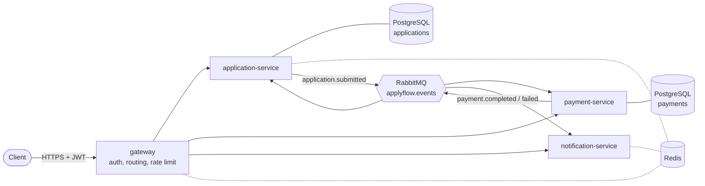
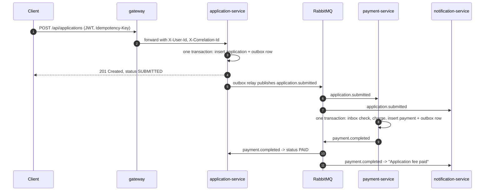

# ApplyFlow

[](https://github.com/neKamita/applyflow/actions/workflows/ci.yml)

Event-driven microservices for processing applications to universities abroad. A student picks a
program, submits an application, the application fee is charged asynchronously, and the student is
notified about every step.

The domain is small on purpose. The project is about the problems that appear as soon as one business
operation spans several services: lost and duplicated messages, retries that charge a card twice,
partial failures, and tracing a request across process boundaries.

**Stack:** Java 25, Spring Boot 4, Spring Cloud Gateway, RabbitMQ, PostgreSQL, Redis, Flyway,
Testcontainers, Docker, Kubernetes, GitHub Actions.

## Architecture



| Service | Responsibility | Storage |
|---|---|---|
| `gateway` | Issues and validates JWTs, routes requests, rate limits submissions | Redis (rate-limit counters) |
| `application-service` | Program catalog, applications and their status | PostgreSQL `applications`, Redis (cache, idempotency keys) |
| `payment-service` | Charges the application fee through a payment provider port | PostgreSQL `payments` |
| `notification-service` | Notifies the applicant about each event | Redis (deduplication, recent notifications) |
| `common` | Event contracts, RabbitMQ topology, transactional outbox and inbox | none |

Each service owns its database; no service reads another service's tables. The services talk to each
other only through events, so payment-service can be down while students keep submitting applications.

### Submitting an application



The client gets a response after step 4. The payment, the status update and the notifications happen
in the background; the client polls `GET /api/applications/{id}`.

## Engineering decisions

### Reliable messaging: transactional outbox

**Problem.** Saving the application and then publishing an event are two separate operations. If the
service crashes between them, the application exists but payment never starts. If the event is sent
first and the commit fails, payment-service charges for an application that does not exist.

**Solution.** The event is written to an `outbox_events` table in the same transaction as the
application ([`OutboxWriter`](common/src/main/java/io/github/nekamita/applyflow/common/outbox/OutboxWriter.java)).
A relay ([`OutboxRelay`](common/src/main/java/io/github/nekamita/applyflow/common/outbox/OutboxRelay.java))
polls the table, publishes with RabbitMQ publisher confirms, and only then marks the rows as published.

The relay selects rows with `FOR UPDATE SKIP LOCKED`, so several replicas can run it at once without
publishing the same row twice. Kubernetes runs two replicas of application-service for this reason.

### At-least-once delivery and idempotent consumers

The outbox guarantees at-least-once delivery, which means duplicates: if the relay crashes after the
broker confirmed but before the update committed, the batch is sent again. Every consumer therefore
deduplicates by event id:

- payment-service and application-service insert the event id into `processed_messages` in the same
  transaction as the side effect ([`InboxStore`](common/src/main/java/io/github/nekamita/applyflow/common/outbox/InboxStore.java)).
  A duplicate hits the primary key and is skipped. A rolled-back attempt leaves no row, so its retry
  is processed normally.
- payment-service also has a unique constraint on `payments.application_id`: even a different event
  about the same application cannot charge twice.
- notification-service has no database; it claims the event id in Redis with `SET NX` and releases the
  claim if sending fails.
- Status transitions are one-way (`SUBMITTED -> PAID | PAYMENT_FAILED`), so a late or reordered event
  cannot move an application back.

### Retries and dead-letter queues

Each consumer owns a durable queue with a dead-letter queue ([`Topology`](common/src/main/java/io/github/nekamita/applyflow/common/messaging/Topology.java)).
A failing message is attempted four times in total with exponential backoff (0.5 s, 1 s, 2 s), then moved to
`<queue>.dlq` instead of blocking the queue or being lost.

payment-service separates two kinds of failure:

| Failure | Example | Handling |
|---|---|---|
| Transient | provider timeout | exception, transaction rolls back, message is retried, then dead-lettered |
| Business | card declined | normal outcome: `DECLINED` payment and a `payment.failed` event |

The provider is called with the application id as its idempotency key, so a retry after a timeout does
not create a second charge on the provider side. In docker compose the simulated provider fails 30% of
attempts on purpose; the logs show the retries.

### Idempotent API

A student on a bad connection presses "Submit" twice, or a mobile client retries after a timeout. Both
requests must produce one application and one charge.
`POST /api/applications` requires an `Idempotency-Key` header
([`IdempotentSubmission`](application-service/src/main/java/io/github/nekamita/applyflow/application/idempotency/IdempotentSubmission.java)):

1. `SET NX` a `PENDING` marker with a hash of the request body in Redis. Only one concurrent request wins.
2. The winner creates the application and stores the result under the key for 24 hours.
3. A repeat with the same key and body returns the original application with `200` and
   `Idempotent-Replayed: true`. A repeat while the first is still running gets `409`. The same key with a
   different body gets `422`.

Redis is the fast path. The unique constraint on `(applicant_id, idempotency_key)` is the source of
truth: if Redis is flushed or unreachable, the database still rejects the duplicate and the service
returns the existing application. There is an integration test for exactly this case.

### Redis

| Use | Where | Why Redis |
|---|---|---|
| Program catalog cache, 10 min TTL, JSON values | application-service | read on every page, changes rarely, shared by all replicas |
| Idempotency keys | application-service | atomic `SET NX` with TTL |
| Rate limiting (token bucket) | gateway | counters shared across gateway replicas |
| Event deduplication and recent notifications | notification-service | short-lived state that does not justify a database |

### Gateway and trust boundary

The gateway is the only entry point. It validates the JWT (HS256) and forwards the token subject as
`X-User-Id`. A client-supplied `X-User-Id` is always removed first; otherwise anyone could act as any
user by setting the header. In Kubernetes a `NetworkPolicy` lets only gateway pods reach the backend
services, so the header cannot be forged from inside the cluster either.

Submissions are rate limited per user (1 per second, bursts of 5). The demo script sends a burst of 12
and expects `429` for the last ones.

### Tracing a request

The gateway assigns an `X-Correlation-Id` (or keeps a safe one from the client). Every service puts it
into the log context, the outbox stores it with the event, and consumers restore it from the event. One
`grep` shows the whole flow:

```text
INFO [application-service,trace-demo-42] Application 55740d4e... submitted for program tum-msc-informatics
INFO [payment-service,trace-demo-42]     Charged 75.00 EUR for application 55740d4e...
INFO [notification-service,trace-demo-42] E-mail to a***@example.com: We received your application...
INFO [application-service,trace-demo-42] Application 55740d4e... paid
```

E-mail addresses are masked in logs. Metrics are exposed at `/actuator/prometheus`, including
`applyflow_payments_total{outcome="completed|declined|transient_failure"}`.

### Kubernetes

The manifests in [`k8s/`](k8s) are plain Kustomize:

- startup, liveness and readiness probes on the Spring Boot health groups;
- rolling updates with `maxUnavailable: 0` and a `PodDisruptionBudget` for every replicated service;
- non-root containers (numeric UID), read-only root filesystem, all capabilities dropped;
- default-deny `NetworkPolicy` with explicit allow rules;
- credentials from a `Secret` generated from a git-ignored `secrets.env`;
- `enableServiceLinks: false`. Without it, Kubernetes injects `REDIS_PORT=tcp://10.x.x.x:6379` for the
  `redis` Service, which overrides the application's `REDIS_PORT` and crashes it on startup.

The numeric UID and the service-links problem both surfaced when the manifests were first deployed to a
real cluster: the pods were rejected or crashed until they were fixed.

## Running it

Requirements: Docker with Compose, `curl`, `jq`. Java is only needed to run the tests outside Docker.

```bash
docker compose up -d --build --wait
./scripts/demo.sh
```

The demo script walks through the whole scenario and fails if anything behaves unexpectedly: public
catalog, `401` without a token, login, submission, idempotent replay, asynchronous payment, notifications,
ownership check, declined card, and rate limiting.

- Gateway: http://localhost:8080
- RabbitMQ management UI: http://localhost:15672 (guest / guest)
- Demo accounts: `aziz` / `aziz-demo-pass`, `malika` / `malika-demo-pass`

Stop with `docker compose down -v`.

### On Kubernetes (kind)

```bash
kind create cluster --name applyflow
docker compose build
for s in application-service payment-service notification-service gateway; do
  kind load docker-image "applyflow/$s:local" --name applyflow
done

cp k8s/secrets.env.example k8s/secrets.env   # then edit the values
kubectl apply -k k8s
kubectl -n applyflow wait --for=condition=Available deploy --all --timeout=5m

kubectl -n applyflow port-forward svc/gateway 8080:80 &
./scripts/demo.sh
```

### Tests

```bash
./mvnw verify
```

Integration tests start real PostgreSQL, RabbitMQ and Redis containers with Testcontainers; nothing in the
infrastructure is mocked. They cover the outbox, duplicate deliveries, the retry-then-dead-letter path,
idempotent submissions including the Redis-lost-the-key case, ownership checks, caching, JWT handling and
header spoofing. CI runs the tests, then starts the stack with docker compose and runs the demo script
against it, then validates the rendered Kubernetes manifests with kubeconform.

## API

All endpoints are called through the gateway.

| Method | Path | Auth | Description |
|---|---|---|---|
| `POST` | `/auth/token` | none | `{"username", "password"}` -> `{"accessToken", "tokenType", "expiresIn"}` |
| `GET` | `/api/programs` | none | Program catalog |
| `GET` | `/api/programs/{id}` | none | One program |
| `POST` | `/api/applications` | JWT, `Idempotency-Key` | `{"programId", "applicantEmail", "paymentToken"}` |
| `GET` | `/api/applications` | JWT | The caller's applications |
| `GET` | `/api/applications/{id}` | JWT | One application; `404` if it belongs to someone else |
| `GET` | `/api/payments/{applicationId}` | JWT | Payment for an application |
| `GET` | `/api/notifications/{applicationId}` | JWT | Notifications sent for an application |

Payment tokens understood by the simulated provider: `tok_visa` (approved), `tok_declined`,
`tok_unavailable` (provider down: retried, then dead-lettered). application-service returns errors as
RFC 9457 problem details.

## Trade-offs and next steps

- **Choreography instead of orchestration.** With two steps, events are simpler than a saga orchestrator.
  With more steps (document checks, university confirmation, refunds) an explicit orchestrator would make
  the flow easier to follow.
- **The provider call runs inside the database transaction.** That holds a connection during the call.
  Fine at this scale; under load it should become a two-step process (record intent, call, record result).
- **Polling outbox.** A 500 ms poll is simple and portable. Change data capture (Debezium) would cut
  latency and database load.
- **notification-service can lose a notification** if it crashes after claiming an event and before
  sending it. Acceptable for notifications, which is why the payment path uses database transactions instead.
- **Authentication is a demo.** Users live in configuration. A real system would use an identity provider
  (Keycloak, Auth0) with RS256 keys and JWKS, and the gateway would only validate tokens.
- **Next:** distributed tracing with OpenTelemetry, a DLQ replay tool, Helm chart, HPA on queue depth.

## Project structure

```text
common/                 event contracts, RabbitMQ topology, outbox, inbox, correlation id
gateway/                Spring Cloud Gateway, JWT, rate limiting
application-service/    catalog, applications, idempotency, payment result listener
payment-service/        payment processing, simulated provider
notification-service/   notifications
k8s/                    Kustomize manifests
scripts/demo.sh         end-to-end scenario used locally and in CI
```

## License

[MIT](LICENSE)
